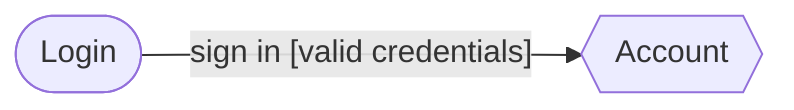
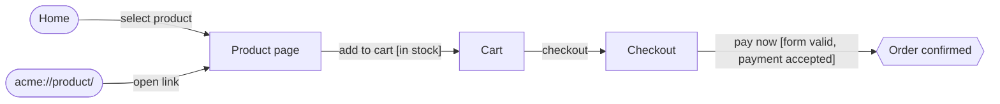

# User journeys

2 journeys across 2 domains. Status: 2 inferred, 0 reviewed, 0 approved. **P1 journeys with no automated tests: 1.**

> Journeys marked `inferred` were derived from the code and describe how the software behaves today, not how it is meant to behave. A person should review each one and set `status: reviewed`.

## account

| ID | Journey | Persona | Priority | Platforms | Automation | Status |
|---|---|---|---|---|---|---|
| JRN-ACC-001 | [Member signs in and views their account](account/JRN-ACC-001-member-signs-in-and-views-their-account.md) | member | P1 | web, ios, android | partial | inferred |

## checkout

| ID | Journey | Persona | Priority | Platforms | Automation | Status |
|---|---|---|---|---|---|---|
| JRN-CHK-001 | [Guest completes checkout with card](checkout/JRN-CHK-001-guest-completes-checkout-with-card.md) | guest | P1 | web, ios, android | none | inferred |

